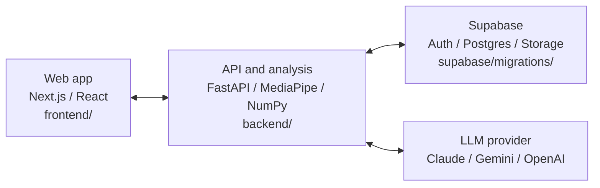

# Alibi

Alibi is a web application that helps lifters review their squat, deadlift, and bench press
technique. Upload a video of a set to get a prioritized form correction, a cue for the next set,
an annotated frame, and a rep-by-rep breakdown.

The application combines pose estimation, measured movement data, and AI coaching. Generated
feedback is checked against the video's measurements before it reaches the lifter. When the
video does not support a reliable assessment, Alibi explains what could not be measured.

## What you can do

- Create an account and upload a lifting video with guidance on camera placement.
- Follow analysis progress, view results, and retry a failed analysis using the saved video.
- Review measured reps, annotated frames, and coaching feedback.
- Browse your history and compare completed sets of the same lift.
- Rate feedback and delete individual uploads or your account.
- As an admin, review analyses and validation attempts and manage the lift fault catalog.

## Application structure



The frontend handles the upload and review experience. The backend authenticates requests,
coordinates video analysis, validates AI output, and saves results. Supabase provides accounts,
relational data, and private media storage. LLM credentials are used only by the backend.

```text
frontend/             Next.js pages, shared components, and browser tests
backend/app/          FastAPI routes, pose analysis, measurements, and feedback validation
backend/tests/        Backend unit and integration tests
backend/scripts/      Pose model download and runtime checks
supabase/migrations/  Database schema, access policies, and seed data
docs/                 User stories, acceptance criteria, and TDD evidence
issues/               GitHub issue definitions and creation scripts
render.yaml           Backend deployment configuration
```

## How analysis works

1. The lifter uploads an MP4 or MOV video and selects a lift.
2. OpenCV reads the video, and MediaPipe estimates body landmarks for sampled frames.
3. The measurement code calculates reps, joint angles, movement metrics, and camera visibility.
4. The configured LLM receives measurements and selected frames and returns structured feedback.
5. A deterministic validator checks the response's schema, cited reps, faults, and measurements.
6. Invalid feedback goes through a correction loop, with at most three attempts. If it still
   fails validation, the application returns verified measurements and the rep breakdown.

Videos with insufficient visibility or usable movement receive an explanation instead of a
coaching result. Completed analyses, their measurements, and validation attempts are saved for
later review.

## Run locally

Prerequisites: Python 3.13, Node.js 22, and npm. The Makefile commands below use a Bash-compatible
environment such as Linux, macOS, or WSL. The real-video setup also uses Docker.

Install dependencies:

```bash
make setup
```

To explore the application without external credentials, start the API in test mode:

```bash
make backend-test-mode
```

In another terminal, start the frontend:

```bash
make frontend
```

Open [localhost:3000](http://localhost:3000). The API runs on
[localhost:8000](http://localhost:8000). Test mode uses in-memory data, synthetic poses, and
mocked AI responses.

For real video analysis:

1. Copy [`backend/.env.example`](backend/.env.example) to `backend/.env` and configure Supabase,
   the database connection, and your LLM provider and key. Keep the real file out of Git.
2. Apply [`supabase/migrations/`](supabase/migrations/) in filename order. The Alpha signup flow
   expects email confirmation to be disabled in Supabase Auth.
3. Stop the test-mode API, then build and start the backend with its model and native libraries:

   ```bash
   docker build -t alibi-api backend
   docker run --rm --env-file backend/.env -e PORT=10000 -p 8000:10000 alibi-api
   ```

For native backend development, install the system libraries listed in
[`backend/Dockerfile`](backend/Dockerfile), run `bash backend/scripts/download_pose_model.sh`,
set `POSE_MODEL_PATH=models/pose_landmarker_full.task` in `backend/.env`, and use `make backend`.

The frontend uses `http://localhost:8000` by default. Set `NEXT_PUBLIC_API_URL` in
`frontend/.env.local` if the API is hosted elsewhere, and include the frontend origin in the
backend's `CORS_ORIGINS`.

## Tests and development

```bash
make test                             # Backend and frontend tests with coverage
npm --prefix frontend run e2e          # Playwright browser tests
docker build -t alibi-api backend      # Build the backend runtime image
docker run --rm alibi-api python scripts/check_pose_runtime.py
```

Automated application tests mock the LLM; CI does not call a real provider. Database migration
and access-policy tests require `TEST_DATABASE_URL` pointing to a disposable Postgres database.
The container check runs real pose inference without application credentials.

Development follows test-driven development: acceptance criteria map to tests, failing tests
are recorded before implementation, and coverage is reported in CI. See the
[user stories and acceptance criteria](docs/User_Stories_and_Acceptance_Criteria.md) and
[TDD evidence](docs/tdd/README.md) for implementation details.

## Deployment

| Component | Host | Configuration |
| --- | --- | --- |
| Frontend | Vercel | Use `frontend/` as the project root and set `NEXT_PUBLIC_API_URL` to the API URL. |
| Backend | Render | Use [`render.yaml`](render.yaml) and [`backend/Dockerfile`](backend/Dockerfile); set backend environment variables in Render. |
| Accounts, data, and media | Supabase | Apply the migrations and configure Auth and the private storage bucket. |
| AI feedback | Configured LLM provider | Set `LLM_PROVIDER`, `LLM_API_KEY`, and optionally `LLM_MODEL` on the backend. |

The backend image includes MediaPipe's native libraries and pose model. A real inference check
runs before the API starts accepting requests. CI also verifies inference in the finished container.

After deploying, check the API's `/health` endpoint and the frontend's `/status` page, then verify
an upload through the complete analysis flow. Configure `CORS_ORIGINS` for the deployed frontend.
