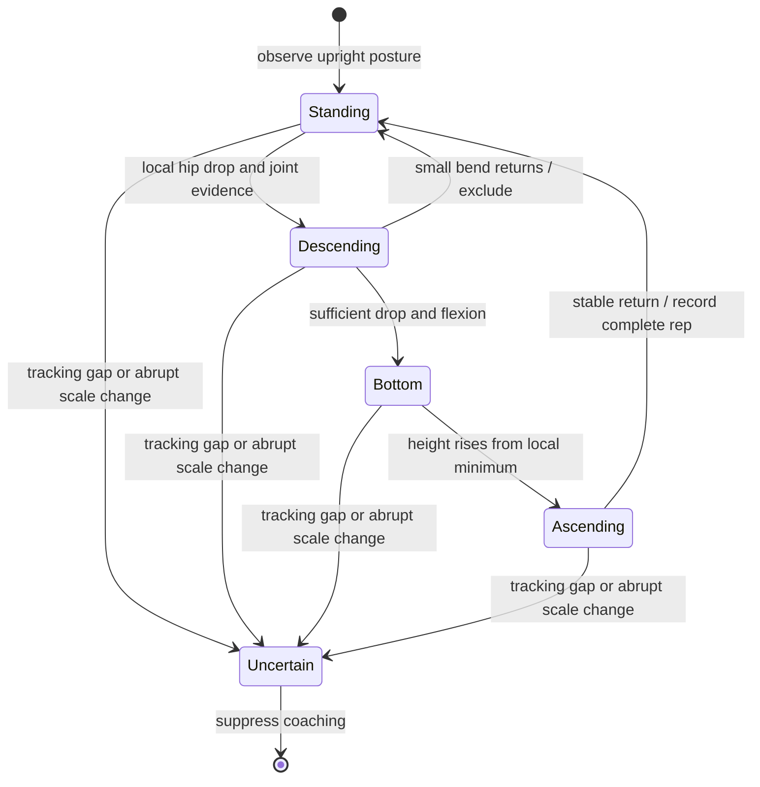

# Video trimming and squat segmentation

Branch: `codex/video-trimming-rep-segmentation`, based on audited main `2346c2c`.
Scope extends US-04 (upload) and US-06 (measurement); US-08 validation remains strict.
The supplied [feature specification](plans/video-trimming-rep-segmentation.md) is preserved.

## Findings and Alpha comparison

Compared Alpha `5e15c33` with audited main `2346c2c` using file diffs and Python AST comparisons:
The machine-readable comparison and before/after intervals are saved in
[`tdd/alpha-comparison.json`](tdd/alpha-comparison.json).

| Component | Alpha → audited main | Consequence |
| --- | --- | --- |
| `measure.count_reps()` and `_fill_gaps()` | Identical | The squat weakness predates the later merge. |
| Squat branch of `height_signal()` | Identical; only press support was added elsewhere | No squat-specific range or confidence fix was introduced. |
| `video.py`, `pose.py` | Identical files | Sampling and pose confidence behavior did not change. |
| `measure_set()` | Added overhead press and RDL dispatch | Squats still used the same one-dimensional height counter. |
| `pipeline.py` | Added saved catalogs and progress callbacks | It still trusted segmentation before asking the LLM for feedback. |

The old signal was hip height relative to the ankles. Its resting height updated locally, but
the descent threshold was **50% of the entire clip's 98th–2nd percentile range**. Return to rest
required recovering to within **20% of that same range**. An unrelated extreme can therefore hide
smaller squats; a changed resting height can also prevent recovery and merge cycles. The counter
recognized only “down” and “back up”; it did not require knee/hip flexion or squat phases.

Confidence was checked using the better-seen side, but hip coordinates were averaged across both
sides anyway. A bad hidden hip could dominate that average. `_fill_gaps()` interpolated every gap,
including long missing spans and edges. Joint measurements also used low-confidence coordinates.
These paths could create plausible-looking numbers for an unrelated bend and supply those numbers
to form rules, worst-frame annotation, and the LLM. The validator checked consistency with the same
numbers; that did not independently establish that the segmented movement was a squat.

A deterministic reproduction combines two complete shallow squats with a forward hinge and injects
a low-confidence error into the far hip during the hinge:

| Synthetic input | Audited counter | New squat segmentation |
| --- | --- | --- |
| Two shallow squats alone | 2 | 2 |
| Two shallow squats + hinge with far-hip tracking error | 1 (the hinge interval) | 2 (squat intervals only) |
| Hinge with that error alone | 1 | 0; no coaching |

This is a **plausible reproduction**, not a reconstruction of the original Red Team video. Neither
that video nor labeled workout videos are present in the repository, so its exact cause cannot be
confirmed from frames. Automated synthetic results are not a real-world accuracy score.
In this reproduction, the bend increased the old clip range from 0.0936 to 0.2473, raising its
descent threshold from 0.0468 to 0.1236—larger than either shallow squat's entire height change.

## Implementation

`app/segmentation.py` now handles squats separately. Other lifts retain their existing height/hinge
counters. Geometry helpers accept only finite, confident landmarks; an unseen joint yields an
unavailable measurement. A reliable side supplies coherent shoulder/hip/knee/ankle observations.

The baseline is the median of up to eight recent upright observations, rather than a global
movement range. Heights are measured relative to the ankles in visible torso lengths, cancelling
translation and tolerating gradual zoom. Three upright observations precede a candidate. Side views
require coordinated knee and hip flexion; front views use projected thigh/shin changes because
sagittal angles are not reliably observable there. Front-view evidence is less specific.

Current engineering defaults, which still need calibration on labeled video:

| Evidence | Default |
| --- | --- |
| Usable landmark | confidence ≥ 0.5 and finite x/y/confidence |
| Candidate descent | hip drop > 0.08 torso lengths; side knee flexion ≥ 12°, hip flexion ≥ 8° |
| Qualifying bottom | hip drop ≥ 0.18 torso lengths; side knee flexion ≥ 30°, hip flexion ≥ 20° |
| Front-view evidence | projected shin shortening > 0.015 at descent, ≥ 0.025 at bottom |
| Ascent | rise ≥ 0.03 torso lengths from the local minimum |
| Complete return | height within 0.08 torso lengths; knee/hip within 12°/15° of local standing |
| Temporal evidence | descent and ascent each ≥ 0.15 s; returned posture ≥ 0.04 s |
| Uncertain tracking | > 0.20 s between usable observations |
| Abrupt camera/pose change | torso scale changes > 35% between usable observations |

Pauses do not extend one rep into the next. Incomplete final movements are excluded and noted.
Another descent after an ascent but before a clear standing return marks the selection uncertain,
instead of merging repeated valleys into one confident rep.
Small walking bobs and hinges do not satisfy the combined bottom evidence. No positions are
interpolated for squat phase detection or form metrics. Legacy out-of-shot height candidates remain
available diagnostically, but are explicitly marked unreliable and cannot produce coaching.

`pipeline.py` rejects unreliable segmentation before requesting LLM feedback. `validator.py`
independently checks the reliability flag, rep ordering, non-overlapping intervals, finite times,
and whether cited evidence frames belong to the rep. Existing schema, safety, fault, and number
checks remain in place. Results and the LLM prompt explicitly call measurements pose estimates,
not independent verification. Matching an estimated count is never described as proving accuracy.

## Optional trimming

The upload form previews the selected file and starts with the **full video**. “Choose a segment”
opens labeled, keyboard-accessible start/end sliders and numeric time controls, a selection bar,
selected duration, preview playback, and “Reset to full video.” No time is removed automatically.
Invalid boundaries block upload. Changing files resets the selection; retries retain it.

The API accepts paired optional `trim_start`/`trim_end` fields. Both must be finite and satisfy
`0 ≤ start < end ≤ source duration`. Invalid requests fail before storage or analysis. Original
MP4/MOV bytes still follow the existing storage/compression workflow; trimming itself never cuts or
re-encodes the video. The saved upload interval survives retries and history reads.

Apply `supabase/migrations/20261117000000_video_trim_bounds.sql` **before** starting this backend.
Its nullable columns preserve full-video behavior for existing uploads, with a database constraint
for paired, ordered, finite boundaries.

The decoder streams selected images into MediaPipe instead of retaining a full-resolution clip in
memory. Sampling is capped at 30 Hz. Source presentation timestamps feed MediaPipe and analysis,
including variable-frame-rate timing; original frame indices remain available for annotation.
The interval is start-inclusive/end-exclusive and is applied **before pose inference**. Rep numbers
restart at 1 within the selection, while feedback times continue to refer to the full video.
Results show the analyzed interval and initially seek the retained video to its start.

There is no in-app recording implementation in this repository, so no recording countdown or new
recording system was added.

## TDD and verification

Failing tests were run before the corresponding production changes. Raw red evidence is in
`docs/tdd/red-rep-segmentation.txt` (6 failures), `red-video-trimming.txt` (13 failures),
`red-video-trimmer-ui.txt` (4 failures), and `red-pose-quality.txt` (3 additional failures).
Further edge cases were recorded in `red-tail-tracking.txt` (1 failure) and
`red-interval-validation.txt` (2 failures) before their fixes.
`red-repeated-descents.txt` records the additional ambiguous-return merge case (1 failure).
`red-unseen-bar.txt` records an unavailable bar path being reported as zero (1 failure); it now remains unavailable.

Acceptance coverage includes two squats plus a bend, walking before/after, five consecutive reps,
pauses, incomplete final reps, camera changes, long missing spans, low-confidence coordinates,
partial landmark dictionaries, unrelated-frame exclusion, inconsistent evidence, all four other
lifts, boundary validation, selected-only inference/feedback, original timestamps, saved retries,
full-video defaults, reset/file replacement, preview playback, and multipart fields.

Verification results are recorded in the adjacent TDD report after the final checks.

## Changed files

| Area | Files |
| --- | --- |
| Phase detection and confidence | `backend/app/segmentation.py`, `measure.py`, `pose.py`, `video.py` |
| Coaching safeguards and estimate disclosure | `backend/app/pipeline.py`, `validator.py`, `results.py`, `llm/prompt.py` |
| Saved selection and retries | `backend/app/main.py`, `uploads.py`, `repository.py`, `testing/fakes.py`, trim-bounds migration |
| Upload preview and playback | `frontend/src/components/VideoTrimmer.tsx`, `UploadForm.tsx`, `ResultsView.tsx`, `lib/api.ts`, `lib/types.ts` |
| Acceptance and regression tests | `test_us04_video_trimming.py`, `test_us06_segmentation_reliability.py`, `test_us06_pose_quality.py`, sequence fixtures, repository/DB tests, upload/UI unit tests, `e2e/us04-trimming.spec.ts` |
| Documentation | README, preserved feature specification, this investigation, TDD logs and report |

## Limits and release validation

2D pose estimates remain sensitive to occlusion, view angle, body proportions, loose clothing,
perspective, moving cameras, multiple people, and sustained high-confidence pose errors. Very
shallow/fast movements or clips starting mid-rep may be excluded. Long tracking loss or abrupt scale
changes conservatively suppress coaching for the selection, including otherwise visible reps.
The other lifts retain their earlier global-range counters and their existing limitations.

Before production release:

1. Run migrations and the PostgreSQL repository/RLS tests on a disposable database; do not run schema-wiping tests on production.
2. Add the original Red Team clip and independently label each squat start/bottom/end and unrelated movement.
3. Evaluate a held-out set of phone videos across views, depths, tempos, pauses, clothing, lighting, and frame rates. Include all five lifts and both trimmed/full uploads.
4. Record count error, missed/extra reps, interval boundary error, false squat detections, rejected selections, and feedback/annotation outside labeled reps. Separate conservative rejection from successful counting.
5. Have a trainer check accepted form feedback and ambiguous/rejected cases; calibrate thresholds without tuning to only the reproduction.
6. Verify real MediaPipe inference in the backend Docker image and complete a staging upload/storage/retry/playback flow before merging or deploying.

No main merge or production deployment is part of this branch.
